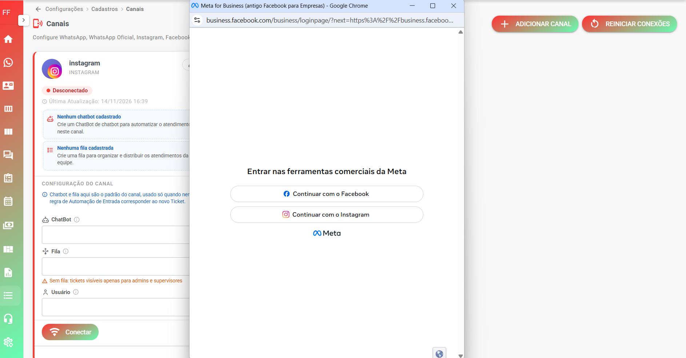
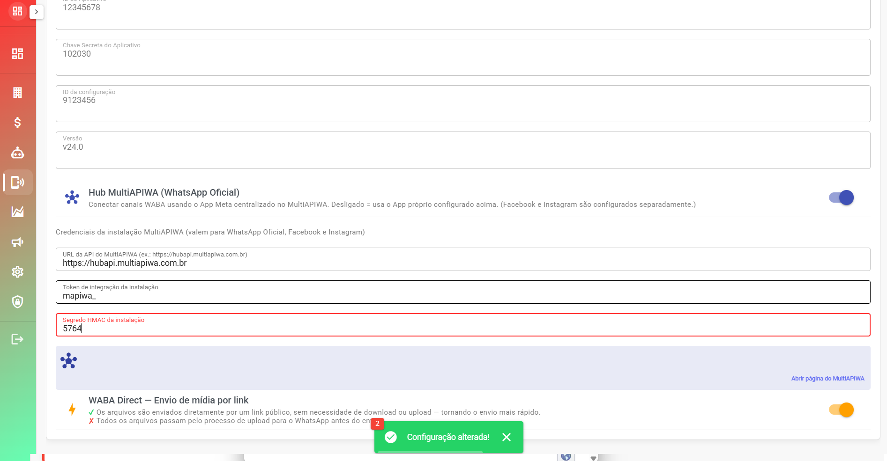
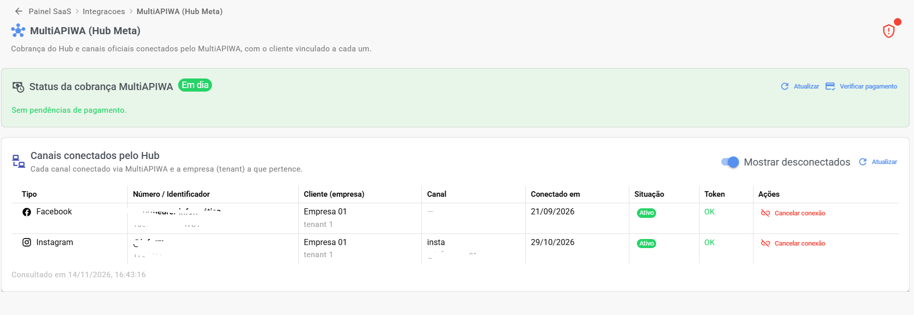

# Hub MultiAPIWA (conexão integrada)

O **Hub MultiAPIWA** é o **hub oficial do Whazing** para conectar os canais oficiais da Meta ao sistema:

* ✅ **WhatsApp Oficial (WABA)**
* ✅ **Instagram**
* ✅ **Facebook (Messenger)**

Com ele, a conexão acontece **dentro do próprio Whazing**: o cliente clica em um botão, a tela oficial da Meta aparece e o sistema conduz cada etapa até o final. **O cliente final não precisa copiar token, criar aplicativo na Meta nem configurar webhook** — o Whazing já faz essa parte.

> 🚫 **Exclusivo do Whazing.**
>
> O Hub MultiAPIWA **funciona somente com o Whazing**. Os dados de instalação que você recebe são criados para o **seu** Whazing e **não funcionam em outros sistemas**. Não é possível reaproveitar as mesmas credenciais em outro painel ou em outra instalação.

> ⚠️ **Uso responsável do número (leia antes de conectar).**
>
> Os canais conectados pelo Hub usam um **aplicativo da Meta centralizado**, compartilhado entre todos os clientes. Por isso, o número **não deve ser usado para envio de spam ou disparo em massa fora das regras da Meta**. Se um número perder **qualidade** (denúncias, bloqueios, mensagens recusadas), o cadastro pode ser **restrito ou bloqueado** — e, como o aplicativo é compartilhado, o problema de um cliente pode **afetar todos os clientes**. Use os canais oficiais apenas para atendimento e comunicações permitidas. Veja a seção **Regras de uso e qualidade do número**, mais abaixo.

***

## 🤔 O que é o Hub, em palavras simples

Para usar um canal oficial, o Whazing precisa de uma **"ponte"** entre o seu canal e a Meta. Existem duas formas de criar essa ponte:

|                                     | **App próprio** (forma tradicional)  | **Hub MultiAPIWA**                       |
| ----------------------------------- | ------------------------------------ | ---------------------------------------- |
| Criar aplicativo na Meta Developers | ✅ Necessário                         | ❌ Desnecessário                          |
| Preencher ID do app e chave secreta | ✅ Necessário (no seu Whazing)        | ❌ Desnecessário                          |
| Copiar tokens e configurar webhook  | ✅ Necessário                         | ❌ Automático                             |
| Onde o cliente conecta              | Em telas técnicas, com vários passos | **Dentro do Whazing, em poucos cliques** |
| Custo                               | Sem cobrança extra por ponte         | **R$ 25,00/mês por canal**               |

Em resumo: **com o Hub, o trabalho técnico fica com o Whazing — e não com o seu cliente.**

> 💡 O Hub é **opcional e escolhido por tipo de canal**. Você pode usar o Hub para Instagram e continuar usando o App próprio para WhatsApp, por exemplo.

***

## 📱 Quais canais o Hub atende

| Canal                       | O que atende                                         | O que o cliente precisa ter                                          |
| --------------------------- | ---------------------------------------------------- | -------------------------------------------------------------------- |
| **WhatsApp Oficial (WABA)** | Atendimento pelo número oficial do WhatsApp Business | Conta no Facebook, Business Manager e número apto para a API Oficial |
| **Instagram**               | Conversas do Direct da conta profissional            | Conta **profissional** do Instagram vinculada a uma página           |
| **Facebook (Messenger)**    | Conversas do Messenger da página                     | Página do Facebook e permissão de administrador                      |

> ✅ É possível ativar **os três**, **dois** ou **apenas um**. Exemplo: _"quero somente Instagram"_ ou _"quero Instagram + Facebook"_. Cada tipo tem o seu próprio botão de ativação.

***

## ✨ O que você ganha no Instagram e no Facebook

Além de conversar no **Direct**, o Hub entrega os recursos das redes sociais:

| Recurso | Para que serve | Passo a passo |
| --- | --- | --- |
| **Responder comentários** | Responder o comentário direto na publicação | [Responder comentários do Instagram](../hub-instagram-facebook-tiktok/facebook-e-instagram-via-hub/responder-comentarios-instagram.md) |
| **Direct automático após comentário** | Quem comentou recebe uma mensagem privada sozinho | [Responder comentários do Instagram](../hub-instagram-facebook-tiktok/facebook-e-instagram-via-hub/responder-comentarios-instagram.md) |
| **Automação de comentários e Direct** | Responder todos os comentários com mensagem fixa ou IA | [Automação de Comentários e Direct](../../funcionalidades/automacao/automacao-de-comentarios-e-direct-do-instagram.md) |
| **Agendar publicações** | Programar Feed, Stories e Reels | [Agendamento de Publicações no Instagram](../../funcionalidades/automacao/agendamento-de-publicacoes-no-instagram.md) |
| **Coexistência (COEX)** | Manter o WhatsApp funcionando no celular |

> 🔁 **Esses recursos não são exclusivos do MultiAPIWA.** Valem igual para o **Hub NotificaMe** e para a **conexão direta** com aplicativo aprovado na Meta. O **ConnectionHub** faz somente Direct.
>
> 📊 Comparativo completo: [O que cada hub faz](../recursos-por-hub.md).

***

## 🔌 Como funciona a conexão (transparente)

A conexão é chamada de **transparente** porque o cliente **não sai do Whazing** e não lida com dados técnicos:

```
Cliente clica em "Conectar"
        ↓
Abre a tela oficial da Meta (login/autorização)
        ↓
Cliente escolhe a empresa, a página ou o número
        ↓
A Meta autoriza
        ↓
O canal é criado no Whazing já funcionando 🎉
```

Na prática, o cliente apenas:

1. escolhe o canal em **Canais → adicionar canal** (WhatsApp Oficial, Instagram ou Facebook);
2. clica no botão de conexão;
3. faz login na Meta e autoriza;
4. volta para o Whazing com o canal pronto.

<figure><figcaption></figcaption></figure>

> 💡 **Dica:** se a janela da Meta não abrir, o navegador pode estar bloqueando pop-ups. Libere os pop-ups para o site do Whazing e clique novamente. No **Firefox**, a própria tela mostra o passo a passo (ícone de escudo 🛡️ na barra de endereço → desativar a proteção para o site).

***

## 🔑 Como conseguir o acesso

O Hub **não é ativado pelo cliente**. Ele é liberado para o **dono do Whazing (você, que administra o SaaS)**:

1. **Solicite o acesso ao suporte Whazing**, informando que quer usar o **Hub MultiAPIWA**.
2. O suporte cria a sua **instalação** e devolve **três dados**:

| Dado recebido                         | Para que serve                                                    |
| ------------------------------------- | ----------------------------------------------------------------- |
| **URL do backend**                    | Endereço do servidor que faz a ponte entre o seu Whazing e a Meta |
| **Token de integração da instalação** | Identifica o seu Whazing perante o Hub                            |
| **Segredo HMAC da instalação**        | Garante que as mensagens trocadas são realmente do seu Whazing    |

3. Você preenche esses três dados **uma única vez** no painel do Whazing.
4. Depois disso, liga o Hub **apenas nos canais que quiser usar**.

> ⚠️ **Muito importante — URL do backend.**
>
> A **URL do backend precisa ser informada** ao suporte (é o endereço pelo qual o seu Whazing é acessado). **Se essa URL mudar** — troca de domínio, mudança de VPS, instalação de túnel/proxy — **você precisa informar novamente**, senão as conexões param de funcionar.
>
> Veja também: [Trocar Domínio](../../instalacao-and-vps/trocar-dominio-instalacao-whazing.md).

O passo a passo completo, com as telas, está na página:

👉 [**Ativar e vender o Hub MultiAPIWA (administrador)**](hub-multiapiwa-ativacao.md)

***

## 🎛️ Como ativar o Hub em cada canal

A ativação é **por tipo de canal**, dentro do Painel SaaS:

| Canal                  | Caminho no Painel SaaS                                      | Botão a ligar                         |
| ---------------------- | ----------------------------------------------------------- | ------------------------------------- |
| **WhatsApp Oficial**   | Painel SaaS → **Integrações** → **WhatsApp Oficial (WABA)** | **Hub MultiAPIWA (WhatsApp Oficial)** |
| **Facebook Messenger** | Painel SaaS → **Integrações** → **Facebook Messenger**      | **Hub MultiAPIWA (Facebook)**         |
| **Instagram**          | Painel SaaS → **Integrações** → **Instagram**               | **Hub MultiAPIWA (Instagram)**        |

Regras simples:

* ✅ As **credenciais são compartilhadas** pelos três canais. Se você já preencheu ao ativar o primeiro canal, **não precisa preencher de novo** nos outros — os campos já estarão lá.
* ✅ Você pode ativar **só um** canal e deixar os outros desligados.
* ⚠️ Com o Hub ligado em um canal, os **Aplicativos próprios** cadastrados naquela tela ficam **inativos** para esse canal (o próprio sistema avisa). Desligar o Hub devolve o canal para a conexão tradicional.

<figure><figcaption></figcaption></figure>

***

## 👥 Para o canal aparecer para o seu cliente

Essa é a parte que mais gera dúvida: **o canal precisa existir em dois lugares ao mesmo tempo.**

| Onde                                                    | O que libera                                              |
| ------------------------------------------------------- | --------------------------------------------------------- |
| **Painel SaaS → Integrações → Canais Disponíveis**      | Diz que aquele tipo de canal **existe no seu SaaS**       |
| **Painel SaaS → Comercial → Planos** (plano do cliente) | Diz que aquele cliente **pode usar** aquele tipo de canal |

Se faltar **um dos dois**, o cliente **não vê** o canal na lista — nem como opção, nem como compra.

> 💡 Regra de bolso: **Canais Disponíveis = o que o seu SaaS oferece. Plano do cliente = o que aquele cliente contratou.**

***

## 💰 Quanto custa

> **R$ 25,00 por mês, por canal conectado.**

* O valor é **por canal** (cada número de WhatsApp, cada conta de Instagram, cada página de Facebook conta como um canal).
* A cobrança é **proporcional aos dias de uso**: entrou no meio do mês, paga só o período usado; cancelou no meio do mês, paga só até o dia do cancelamento.
* **Valor mínimo: R$ 10,00 por canal.** Se o cálculo proporcional der menos que isso, vale o mínimo.

### Exemplos

**Exemplo 1 — três canais o mês inteiro**

| Canal                   | Valor        |
| ----------------------- | ------------ |
| WhatsApp Oficial (WABA) | R$ 25,00     |
| Instagram               | R$ 25,00     |
| Facebook                | R$ 25,00     |
| **Total do mês**        | **R$ 75,00** |

**Exemplo 2 — canal conectado no meio do mês**

Um canal conectado no dia 16, em um mês de 30 dias: você paga **apenas os dias em que ele ficou ativo**, não os R$ 25,00 cheios. Se a conta proporcional ficar abaixo de R$ 10,00, entra o **mínimo de R$ 10,00**.

> ⚠️ **Não confunda as cobranças.** O valor do Hub é só pela **ponte de conexão**. As **mensagens** da API Oficial são cobradas **pela Meta**, direto na sua conta Meta — isso é outra fatura, de outro fornecedor.

***

## 🧾 Como funciona a cobrança

| Item                         | Como funciona                                                           |
| ---------------------------- | ----------------------------------------------------------------------- |
| **Quando a fatura é gerada** | Todo dia **01** do mês                                                  |
| **Vencimento**               | Dia **10**                                                              |
| **Se atrasar**               | O serviço é **bloqueado automaticamente**                               |
| **Formas de pagamento**      | **InfinityPay**: **Pix sem taxa** e **cartão** (com as taxas do cartão) |
| **Cobrança proporcional**    | Sim, pelos dias de uso, com mínimo de R$ 10,00 por canal                |

> 💡 Enquanto o mês está em andamento, o painel mostra uma **estimativa** do valor até agora; a fatura fechada aparece depois do dia 01.

### 💳 O pagamento do Hub é separado do Whazing

O Hub tem **cobrança própria**, **separada da licença do Whazing** e **separada das mensagens cobradas pela Meta**. São três coisas diferentes:

```
Licença do Whazing   →  o que você paga pelo sistema
Hub MultiAPIWA       →  o que você paga pelos canais oficiais conectados (R$ 25/canal)
Mensagens da Meta    →  o que a Meta cobra pelo envio na API Oficial
```

### 📍 Onde você vê e paga a fatura do Hub

No Whazing:

**Painel SaaS → Integrações → MultiAPIWA (Hub Meta)**

Nessa página você encontra:

* o **status da cobrança**: **Em dia**, **Em carência** ou **Bloqueado**;
* o **valor em aberto** e a **data de vencimento**;
* o aviso de **"Regularize até {data} para evitar o bloqueio automático"** (quando em carência);
* o botão **Abrir link de pagamento** (página do InfinityPay, com Pix e cartão);
* os botões **Atualizar** e **Verificar pagamento**;
* a tabela **"Canais conectados pelo Hub"**.

<figure><figcaption></figcaption></figure>

> ℹ️ O cartão **"MultiAPIWA (Hub Meta)"** só aparece no menu quando o Hub está ligado em **pelo menos um** canal.

> ⚠️ Se a fatura do Hub não for paga, os canais **param de funcionar** até a regularização — o bloqueio é automático e não depende do suporte.

***

## 🖥️ Painel do Hub (site)

Além do painel do Whazing, o Hub tem um **site próprio**, acessado com o **usuário e senha** enviados quando o acesso é liberado. No menu lateral:

| Área                     | O que você encontra                                                                                     |
| ------------------------ | ------------------------------------------------------------------------------------------------------- |
| 🏠 **Início**            | Visão geral da conta                                                                                    |
| 🔗 **Meus canais**       | Canais conectados, com número/identificador, situação e valor mensal. É onde se **desconecta** um canal |
| 🩺 **Saúde dos números** | Qualidade e status que a Meta informa sobre os números                                                  |
| 🧾 **Faturas**           | Cobranças com vencimento, valor e situação — e o botão **Pagar**                                        |
| 💳 **Pagamentos**        | Histórico dos pagamentos e recibos                                                                      |
| ⚡ **Atividade**          | Registro dos eventos da conta                                                                           |
| 👤 **Minha conta**       | Dados de acesso                                                                                         |
| ❓ **Ajuda**              | Suporte                                                                                                 |

***

## ⚠️ Regras de uso e qualidade do número

Este é o ponto mais importante da página. **O Hub não é uma ferramenta de disparo em massa.**

### ❌ Não faça

* Envio de **spam**, listas compradas ou mensagens não solicitadas;
* **Disparo em massa** para contatos que não autorizaram o recebimento;
* Uso de canais oficiais para burlar as regras ou os limites da Meta;
* Reaproveitar a mesma credencial de instalação em outro sistema ou em outra instalação.

### ✅ Faça

* Atendimento a clientes que **iniciaram** a conversa;
* Uso de **templates aprovados** quando a conversa estiver fora da janela de 24 horas;
* Acompanhamento da **saúde do número** no painel do Hub;
* Respeito às [políticas do WhatsApp Business](https://business.whatsapp.com/policy).

### O que acontece se as regras não forem respeitadas

```
Mensagens recusadas / denúncias
        ↓
A qualidade do número cai (a Meta informa isso no painel)
        ↓
O número pode ser restrito e depois bloqueado
        ↓
O cadastro pode ser suspenso — e, por ser um app centralizado,
o problema pode atingir outros clientes do Hub
```

> 🚨 **Por que isso afeta todo mundo:** no Hub, o aplicativo da Meta é **centralizado**. Um número com muitos bloqueios e denúncias compromete a reputação do conjunto. É por isso que o uso indevido é tratado como **risco para todos os clientes** — e pode levar à **suspensão do canal ou da instalação**.

> 💡 Se o seu objetivo é **campanha em massa**, use os canais e recursos próprios para isso (campanhas na API não oficial, SMS, e-mail) e mantenha os canais oficiais para **atendimento**.

***

## ❌ Como cancelar (desconectar) um canal

O cancelamento pode ser feito **pelo painel do Hub** ou **pelo próprio Whazing**.

### Pelo painel do Hub

1. Acesse o **painel do Hub** com seu usuário e senha.
2. Menu lateral → **Meus canais**.
3. Localize o canal e clique em **Desconectar**.
4. Confirme.

### Pelo Whazing

1. Acesse **Painel SaaS → Integrações → MultiAPIWA (Hub Meta)**.
2. Na tabela **"Canais conectados pelo Hub"**, localize o canal na coluna **Número / Identificador**.
3. Clique em **Cancelar conexão** e confirme.

**O que acontece depois do cancelamento:**

* O canal **deixa de receber eventos** da Meta — ou seja, **para de receber mensagens** no Whazing;
* A **cobrança daquele canal é encerrada**;
* O período já usado é cobrado **proporcionalmente** (respeitando o mínimo de R$ 10,00);
* O canal **não é apagado** da empresa no Whazing — ele continua na lista, marcado como **Desconectado** (use **"Mostrar desconectados"** para exibi-lo ou ocultá-lo);
* Para voltar a usar, é necessário **conectar de novo**.

> ⚠️ **Atenção:** cancelar a conexão **corta o atendimento por aquele canal**. Se a intenção é só **parar de usar o Hub** mantendo o número funcionando, isso precisa ser tratado antes (voltando o canal para a conexão tradicional, com App próprio) — fale com o suporte.

***

## 🔎 Como conferir os canais conectados

Na página **Painel SaaS → Integrações → MultiAPIWA (Hub Meta)**, a tabela **"Canais conectados pelo Hub"** mostra:

| Coluna                     | O que significa                                                                      |
| -------------------------- | ------------------------------------------------------------------------------------ |
| **Tipo**                   | WhatsApp, Instagram ou Facebook                                                      |
| **Número / Identificador** | O número ou usuário do canal                                                         |
| **Cliente (empresa)**      | A empresa (tenant) dona daquele canal                                                |
| **Canal**                  | O nome do canal dentro do Whazing                                                    |
| **Conectado em**           | Data da conexão                                                                      |
| **Situação**               | **Ativo**, **Conectando**, **Com erro**, **Desconectado** ou **Pausado (pendência)** |
| **Token**                  | **OK**, **Vai expirar**, **Expirado**, **Inválido** ou **Sincronizando**             |
| **Ações**                  | **Cancelar conexão**                                                                 |

> 🔑 **Token "Vai expirar", "Expirado" ou "Inválido":** significa que o cliente precisa **reconectar** o canal. A própria página mostra um aviso com a quantidade de canais que precisam de atenção.

***

## 🆘 Problemas comuns

### O canal não aparece para o cliente

Falta liberar em **um dos dois lugares**: o tipo no seu **plano** (Painel SaaS → Comercial → Planos) ou o tipo em **Canais Disponíveis**. Veja a seção **Para o canal aparecer para o seu cliente**, acima.

### O menu "MultiAPIWA (Hub Meta)" não aparece no Painel SaaS

Ele só aparece quando o Hub está **ligado em pelo menos um canal** (WhatsApp, Instagram ou Facebook).

### "A janela da Meta não abre"

O navegador está bloqueando pop-ups. Libere os pop-ups para o site e clique novamente. No Firefox, siga o passo a passo que a própria tela mostra.

### "Conectei, mas o canal não aparece"

Aguarde alguns instantes e use **Atualizar** na página do MultiAPIWA. Se persistir, confira se o cliente tem o canal liberado no plano.

### Aparece "Em carência" ou "Bloqueado"

Existe **fatura do Hub em aberto**. Regularize até a data mostrada na própria página (link de pagamento no card) para evitar o bloqueio automático dos canais.

### Aparece "Token precisa reconectar"

O token da Meta expirou ou está inválido. Peça ao cliente para **reconectar o canal**; o atendimento volta ao normal depois disso.

### As mensagens pararam de chegar depois de trocar o domínio

A **URL do backend** mudou. Informe a nova URL ao suporte do Whazing — sem isso a ponte não encontra o seu sistema.

### "Erro ao conectar" ou autorização negada na Meta

Normalmente é permissão: o usuário que está conectando precisa ser **administrador** da página/conta comercial e a conta precisa estar com o cadastro em ordem na Meta.

***

## ❓ Perguntas frequentes

#### O que é o Hub MultiAPIWA?

É o hub oficial do Whazing para conectar **WhatsApp Oficial (WABA)**, **Instagram** e **Facebook** sem configurações técnicas: a conexão acontece dentro do próprio Whazing.

#### Funciona em outro sistema?

**Não.** O Hub é **exclusivo do Whazing**. Os dados de instalação são vinculados ao seu Whazing e não funcionam em outro painel.

#### Quais canais posso usar?

Os três: **WhatsApp Oficial**, **Instagram** e **Facebook** — e você escolhe quais ativar.

#### Preciso ativar os três?

Não. Pode ativar **só um**, dois ou os três, independentemente. Exemplo: apenas Instagram, ou Instagram + Facebook.

#### Quem ativa o Hub?

O **dono do Whazing (administrador do SaaS)**, pelo Painel SaaS. O cliente final só conecta o canal.

#### O cliente precisa informar token ou webhook?

**Não.** Ele apenas faz login na Meta e autoriza. As credenciais técnicas ficam no seu Painel SaaS, preenchidas uma única vez.

#### Preciso informar a URL do backend?

**Sim.** A URL do backend precisa ser informada ao suporte — e, **se ela mudar**, precisa ser informada novamente, senão as conexões param.

#### Quanto custa?

**R$ 25,00 por mês, por canal conectado**, com **mínimo de R$ 10,00** na cobrança proporcional. É separado da licença do Whazing.

#### Como é cobrado?

Fatura gerada no **dia 01**, vencimento no **dia 10**. Pagamento por **InfinityPay** (**Pix sem taxa**, cartão com as taxas do cartão). Atraso = **bloqueio automático**.

#### Onde pago a fatura do Hub?

Em **Painel SaaS → Integrações → MultiAPIWA (Hub Meta)**, pelo botão **Abrir link de pagamento** (ou pelo painel do Hub, em **Faturas**).

#### A cobrança do Hub inclui as mensagens da Meta?

**Não.** A Meta cobra as mensagens da API Oficial separadamente. O Hub cobra apenas a ponte de conexão.

#### Posso usar o número para disparo em massa?

**Não.** O uso é para atendimento, dentro das regras da Meta. Spam e disparo em massa derrubam a **qualidade do número**, podem bloquear o cadastro e, por o aplicativo Meta ser centralizado, **afetam todos os clientes**.

#### O número pode ser banido mesmo sendo API Oficial?

**Sim.** A API Oficial também está sujeita às regras da Meta. Número com qualidade baixa pode ser restrito ou bloqueado.

#### Continuo usando o WhatsApp no celular?

Sim, quando o canal estiver em **Coexistência (Coex)**. Veja [Configuração do WABA Incorporado (Coexistência)](configuracao-do-waba-incorporado-coexistencia.md).

#### Posso cancelar um canal quando quiser?

Sim. Pelo painel do Hub ou pelo Whazing (**Cancelar conexão**). O período usado é cobrado proporcionalmente, com mínimo de R$ 10,00.

#### Posso vender esse canal para os meus clientes?

Sim — é exatamente para isso que existem os **planos** e os **adicionais**. Veja a seção **Vender o canal como adicional** em [Ativar e vender o Hub MultiAPIWA](hub-multiapiwa-ativacao.md).

***

## 📚 Veja também

* [**Ativar e vender o Hub MultiAPIWA (administrador)**](hub-multiapiwa-ativacao.md) — credenciais, ativação por canal e venda em planos/adicionais
* [Canais Adicionais (venda aos seus clientes)](../../modulo-saas/criacao-de-planos-financeiro/adicionais-de-canais.md)
* [Adicionais](../../modulo-saas/criacao-de-planos-financeiro/adicionais.md)
* [API Oficial do WhatsApp (Meta)](api-oficial-do-whatsapp-meta.md)
* [API Oficial do WhatsApp — FAQ Completo](api-oficial-do-whatsapp-faq-completo.md)

***

## Suporte

Em caso de dúvidas, entre em contato:

📱 WhatsApp: +55 48 3197-0877

📱 WhatsApp: +55 48 3197-0599

O atendimento inicial é realizado por um assistente virtual.

Para falar com nossa equipe, envie:

**Atendimento Humano**
