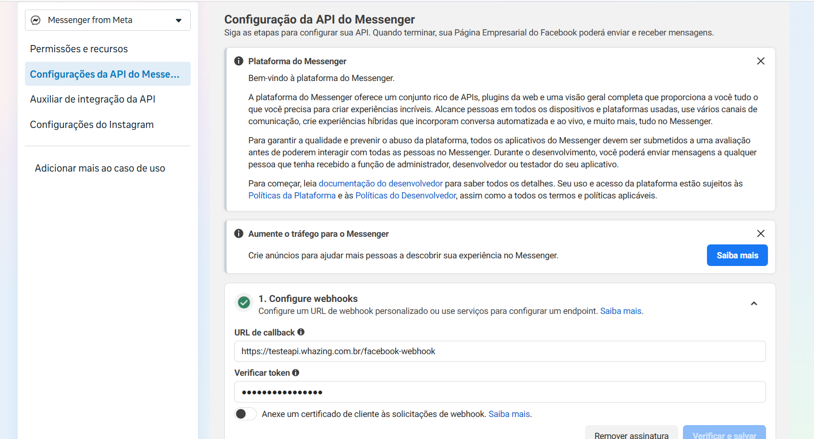
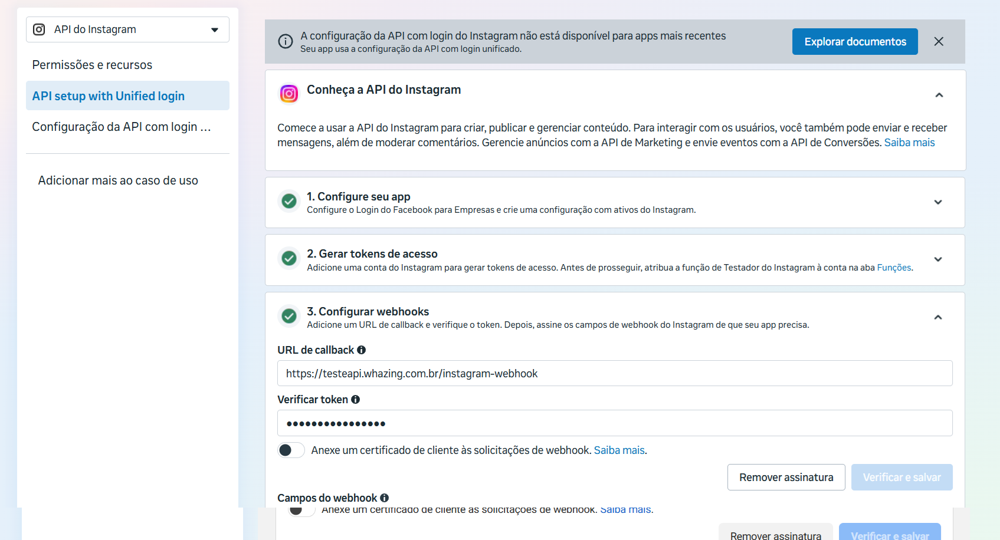
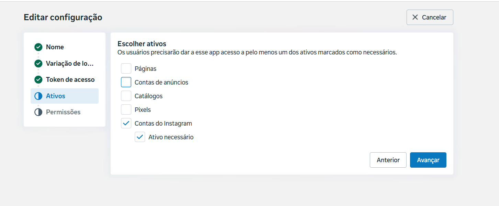
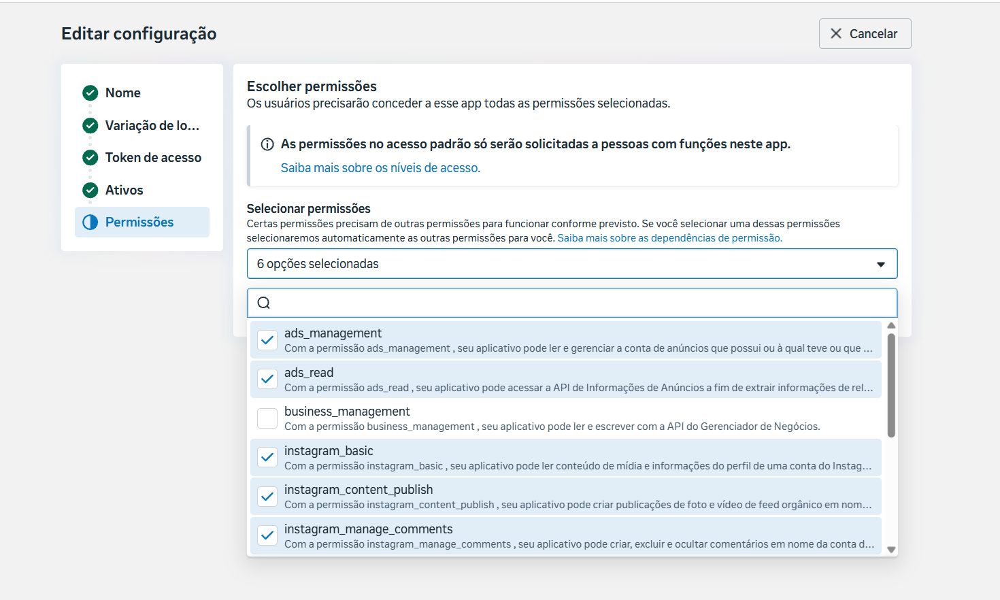
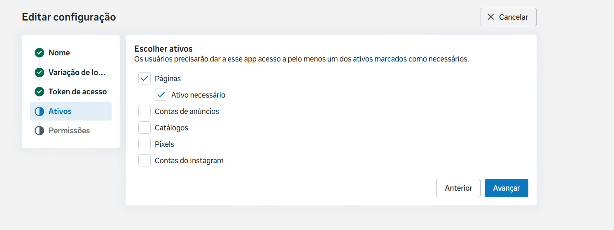
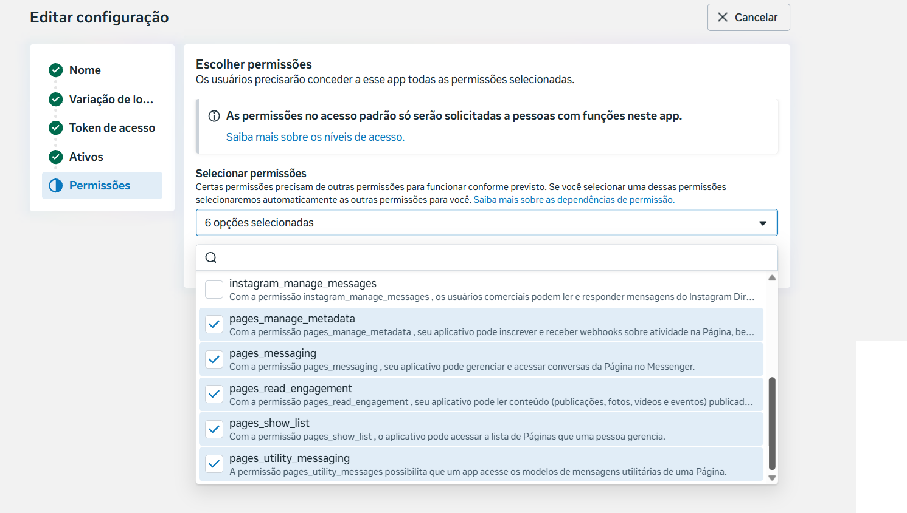
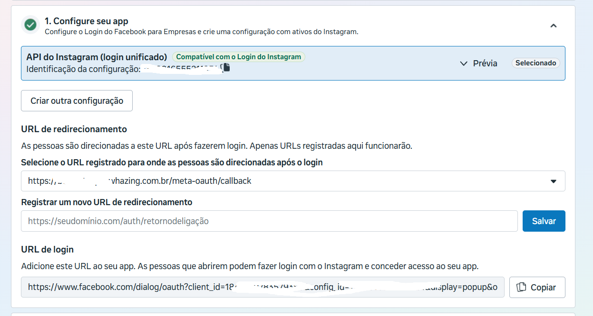

# Criar aplicativo na Meta

Este guia mostra como criar o **aplicativo próprio** usado na conexão direta de **Instagram** e **Facebook**.

> ⚠️ **Nível avançado.** O suporte Whazing **não cria, não configura e não aprova** aplicativos na Meta. Se preferir que alguém faça por você, existe **consultoria por R$ 1.000,00** (criação + condução da aprovação). Se quiser o caminho fácil, use o [Hub MultiAPIWA](../hubs/multiapiwa/README.md).

> ⚠️ **A Meta muda nomes de menus com frequência.** Os caminhos abaixo usam os nomes atuais do App Dashboard. Se um item não existir com esse nome, procure o equivalente (ex.: _Casos de uso_, _Produtos_, _Configurações do app_).

***

## ✅ Pré-requisitos

Antes de começar, você precisa ter:

* [ ] Conta no [Meta for Developers](https://developers.facebook.com/) com **verificação em duas etapas** ativa;
* [ ] Um **Business Manager** (Portfólio Empresarial) com a **verificação de negócio** concluída;
* [ ] **Instagram profissional** (comercial ou criador) **vinculado a uma Página do Facebook**;
* [ ] Uma **Página do Facebook** da qual você é administrador;
* [ ] **Política de Privacidade** e **Termos de Serviço** publicados em URL pública (o app reprova sem isso);
* [ ] A **URL pública do seu Whazing** (a mesma que os clientes acessam) — usada nos redirects.

> 💡 **Verificação de negócio é obrigatória** quando o app é usado por pessoas **sem função (role) no app** — que é o caso de um SaaS com clientes.

***

## 🧭 Passo 1 — Escolher o método de login

O Whazing aceita **dois métodos**. Escolha o que combina com o seu cenário — e confira quais permissões você já tem **aprovadas** para ele (veja [Permissões e aprovação](permissoes-e-aprovacao-meta.md)).

| Método no Whazing                           | Quando usar                                                                                                                     | Credenciais que você vai colar                                                                                              |
| ------------------------------------------- | ------------------------------------------------------------------------------------------------------------------------------- | --------------------------------------------------------------------------------------------------------------------------- |
| **Instagram Login** (`graph.instagram.com`) | Quer conectar **só Instagram**, com login direto da conta — **não exige Página nem conta do Facebook**                          | **Instagram App ID** + **Instagram App Secret** (em _Instagram → API setup with Instagram login → Business login settings_) |
| **Unified Login** (`graph.facebook.com`)    | Quer Instagram **e** Facebook no **mesmo app**, com login pelo Facebook; necessário para ativos de um **Portfólio Empresarial** | **App ID** + **App Secret** da Meta (_Configurações do app → Básico_) + **`config_id`**                                     |

> ⚠️ **Um método por canal.** Cada método usa uma **família de permissões** própria. Configure no canal o método cujas permissões o seu app tem **aprovadas** — se o app está aprovado nas duas famílias (caso comum de quem já passou pelo App Review), você pode oferecer os dois métodos. Detalhes em [Permissões e aprovação](permissoes-e-aprovacao-meta.md).
>
> 💡 No **Unified Login**, o `config_id` é **obrigatório**. Ele vem de uma **Configuração** criada em _Facebook Login for Business_. Para conectar **Páginas pessoais** (sem Portfólio), é possível desligar o uso do `config_id` no Whazing.

***

## 🏗️ Passo 2 — Criar o aplicativo

1. Acesse [developers.facebook.com/apps](https://developers.facebook.com/apps) → **Criar aplicativo**.
2. Informe o **nome** (é o nome que o cliente verá na tela de autorização) e o **e-mail de contato**.
3. Escolha o **caso de uso** conforme o canal:

| Canal                           | Caso de uso a escolher                                                                   |
| ------------------------------- | ---------------------------------------------------------------------------------------- |
| **Facebook (Messenger)**        | **Engage with customers on Messenger** (_Engajar clientes no Messenger_)                 |
| **Instagram (Instagram Login)** | **Manage messaging and content on Instagram** → opção **API setup with Instagram Login** |
| **Instagram (Unified Login)**   | **Manage messaging and content on Instagram** → opção **API setup with Facebook Login**  |

4. Selecione o **Portfólio Empresarial** (Business Manager) ao qual o app pertence.
5. Finalize a criação.

> 📌 **Um app pode atender Instagram e Facebook** se você usar o **Unified Login** e adicionar os dois casos de uso/produtos. Com **Instagram Login** separado, o normal é ter **dois apps**.

***

## 🔑 Passo 3 — Copiar App ID e App Secret

### Instagram Login

1. No menu lateral, abra **Instagram** → **API setup with Instagram login**.
2. Em **Business login settings**, copie:
   * **Instagram App ID**;
   * **Instagram App Secret** (clique em _Show_).

### Unified Login / Facebook

1. Abra **Configurações do app → Básico**.
2. Copie:
   * **ID do aplicativo** (App ID);
   * **Chave secreta do aplicativo** (App Secret).

> 🔒 **App Secret é senha.** Ele fica salvo no seu Painel SaaS e nunca deve ser publicado, enviado em grupo ou aparecer em prints.

***

## 🔗 Passo 4 — Configurar a URL de redirecionamento (OAuth)

Sem isso a conexão falha com o erro **"URL bloqueada"**.

### Instagram Login

Em **Instagram → Business login settings → OAuth redirect URIs**, adicione **exatamente**:

```
https://SEU-DOMINIO/meta-oauth/callback
```

_(Use a URL indicada na tela do Whazing — ela é gerada a partir do seu domínio.)_

### Unified Login / Facebook

Em **Facebook Login for Business → Configurações**, ative **Login OAuth do Cliente/Web** e adicione **exatamente** a URL em **Valid OAuth Redirect URIs**:

```
https://SEU-DOMINIO/meta-oauth/callback
```

> ⚠️ A URL precisa ser **idêntica** (inclusive `https` e sem barra no final). Divergência de uma letra gera "URL bloqueada".

***

## 📡 Passo 5 — Configurar o Webhook

O webhook é por onde a Meta **entrega as mensagens** ao Whazing.

1. No Painel SaaS, abra **Integrações → Instagram** (ou **Facebook Messenger**) e localize a tela **Apps Meta**.
2. A própria tela mostra a **Callback URL** e permite **copiar o Verify Token** de cada App.
   * Callback URL do Instagram: `.../instagram-webhook`
   * Callback URL do Facebook: `.../facebook-webhook`
3. No App Dashboard, abra **Webhooks** (ou o webhook do produto) e informe:
   * **Callback URL** (copiada do Whazing);
   * **Verify Token** (copiado do Whazing — botão de copiar ao lado do valor).
4. Clique em **Verificar e salvar**. Se der erro, confira se a URL está **pública** e com **HTTPS válido**.
5. **Assine os campos** necessários:

| Canal                    | Campos que precisam estar assinados                                                                               |
| ------------------------ | ----------------------------------------------------------------------------------------------------------------- |
| **Instagram**            | `messages`, `messaging_postbacks`, `message_reactions`, `comments`, `mentions`, `live_comments`                   |
| **Facebook (Messenger)** | `messages`, `messaging_postbacks`, `messaging_optins`, `message_reactions`, `message_deliveries`, `message_reads` |

> ⚠️ **`messages` é o mais importante** — sem ele o canal conecta mas **não recebe nada**.

<figure><figcaption></figcaption></figure>

<figure><figcaption></figcaption></figure>

***

## 🖥️ Passo 6 — Preencher e ativar o aplicativo

1. No App Dashboard, em **Configurações do app → Básico**, preencha:
   * **URL da Política de Privacidade**;
   * **URL dos Termos de Serviço**;
   * **Categoria** e **ícone** do app;
   * **Domínios do app** (seu domínio).
2. Confira o **modo** do app: em **Desenvolvimento**, só quem tem função no app consegue conectar. Para clientes, ele precisa estar **Ativo** (o que exige os passos de [Permissões e aprovação](permissoes-e-aprovacao-meta.md)).
3. No Whazing, abra **Painel SaaS → Integrações → Instagram** (ou **Facebook Messenger**) → **Novo App Meta** e preencha:

| Campo no Whazing                 | O que informar                                                                         |
| -------------------------------- | -------------------------------------------------------------------------------------- |
| **Nome (identificação interna)** | Um nome para você reconhecer (ex.: `App principal 2026`)                               |
| **App ID**                       | Instagram App ID (Instagram Login) **ou** App ID da Meta (Unified Login)               |
| **App Secret**                   | O segredo correspondente ao App ID informado                                           |
| **Versão da Graph API**          | A versão usada nas chamadas (ex.: `v23.0`)                                             |
| **Método de login da Meta**      | **Instagram Login** ou **Unified Login**                                               |
| **config\_id**                   | Obrigatório no Unified Login; **obrigatório** para Páginas de um Portfólio Empresarial |
| **Usar config\_id no OAuth**     | Desligue apenas para **Páginas pessoais**                                              |
| **Empresas que usam este App**   | Vazio = vale para quem **não tem** App próprio definido                                |
| **Ativo**                        | Ligue para o App ser usado nas conexões                                                |

4. Clique em **Testar credenciais** — o sistema confirma se App ID/Secret estão válidos.
5. Se este for o único app, marque-o como **Padrão**.

<figure><figcaption></figcaption></figure>

<figure><figcaption></figcaption></figure>

<figure><figcaption></figcaption></figure>

<figure><figcaption></figcaption></figure>

<figure><figcaption></figcaption></figure>

> 💡 **Vários apps:** você pode cadastrar mais de um app no mesmo canal e **vincular cada um a empresas específicas**. O app marcado como **padrão** atende quem não tem vínculo próprio.

***

## 🎫 Passo 7 — Sobre o token

Na conexão direta, o acesso é concedido por **token do usuário** — ele **expira**. Consequências práticas:

* O canal pode parar de receber mensagens depois de um tempo;
* O cliente precisa **reconectar** (autorizar novamente) em **Canais**;
* A tela do Whazing sinaliza canais que precisam de atenção.

> 💡 **Token de Página de longa duração** e revisões periódicas de permissão ajudam, mas **não eliminam** a necessidade de reconectar. Se isso for um problema operacional, o [Hub MultiAPIWA](../hubs/multiapiwa/README.md) resolve justamente essa parte.

***

## 🆘 Problemas comuns

### "URL bloqueada" ao conectar

A **URL de redirecionamento** não está cadastrada (ou está diferente) no App Dashboard. Revise o Passo 4 — precisa ser **exatamente** a URL mostrada pelo Whazing.

### "App not active" / "aplicativo em desenvolvimento"

O app está em **modo de desenvolvimento**. Só quem tem função no app conecta. Publique o app (**Ativo**) após aprovar as permissões.

### Webhook não verifica

* URL precisa ser **pública** e **HTTPS** válido;
* **Verify Token** precisa ser o mesmo gerado no Whazing;
* Se você trocou de domínio, **atualize a Callback URL** nos dois lados.

### Conecta, mas não recebe mensagens

Campo **`messages`** não assinado no webhook, ou **Instagram não vinculado à Página**. Confira as duas coisas.

### "Testar credenciais" falha

App ID e App Secret não são do mesmo app, ou você colou o **Instagram App Secret** junto com o **App ID da Meta** (mistura de métodos de login).

### Conta do Instagram não aparece para conectar

A conta precisa ser **profissional** e estar **vinculada a uma Página** (no caso do Unified Login). No Instagram Login, a conta precisa aceitar o convite de login do app.

***

## Veja também

* [Permissões e aprovação na Meta](permissoes-e-aprovacao-meta.md)
* [Conectar o canal direto](conectar-canal-direto.md)
* [Hub MultiAPIWA (conexão integrada)](../hubs/multiapiwa/README.md)
* [API Oficial do WhatsApp (Meta)](../api-oficial/api-oficial-do-whatsapp-meta.md)
