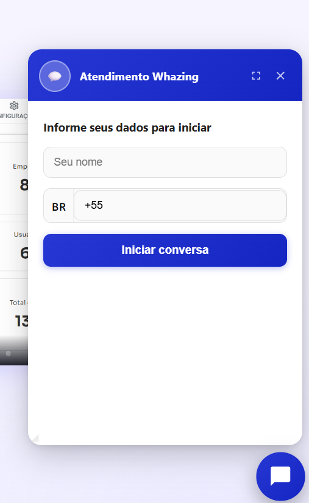
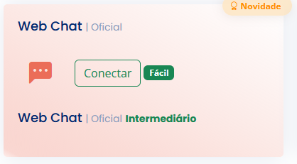

# 💬 WebChat — Atendimento pelo seu site

O **WebChat** é um **chat ao vivo que você coloca no seu site**. O visitante clica no botão de chat, escreve a mensagem e a conversa chega **direto no seu sistema de atendimento**, como se fosse um WhatsApp.

O mesmo chat pode ser entregue de **três formas** — você escolhe na aba **Instalação** do widget:

* **Ícone flutuante:** um botão de chat fica no canto do site e abre quando o visitante clica.
* **Dentro da página:** o chat ocupa um espaço fixo dentro de uma página do seu site, sem botão flutuante.
* **Link público:** um endereço que abre o chat em tela cheia, sem precisar de site — bom para divulgar em redes sociais e para testar o atendimento.

As três formas usam **o mesmo widget e a mesma configuração**. Muda apenas o jeito de colocar no ar.

<figure><figcaption></figcaption></figure>

***

## ✅ Para que ele serve

* Receber mensagens de clientes e visitantes **pelo site**, sem precisar de WhatsApp.
* Atender essas conversas no mesmo lugar onde você já atende os outros canais.
* Saber **quem** está falando: o formulário inicial pede nome, telefone e e-mail (você escolhe o que é obrigatório).
* Personalizar **cores, textos e logo** para combinar com a sua marca.
* Controlar **em quais sites** o chat pode aparecer.
* Divulgar um **link direto do chat** (por exemplo, na bio de uma rede social) ou colocar o chat **embutido** no meio de uma página.

**Não é necessário contratar um HUB (como o NotificaMe) para ter chat no site:** o Whazing já tem **WebChat nativo**, sem custo adicional do Whazing. Se um dia você usar um provedor HUB para WebChat, as cobranças seriam do próprio provedor — não do Whazing.

***

## 📍 Onde encontrar e como criar

1. Faça login no sistema.
2. No menu lateral, entre em **Cadastros → Canais**.
3. Clique em **Adicionar Canal**, localize **Webchat** e escolha essa opção.
4. Dê um **nome ao canal** e salve.
5. No cartão do canal criado, clique no botão **Widget** (esse botão aparece apenas para **administradores**).
6. Preencha os campos nas abas **Configuração**, **Aparência** e **Comportamento**. Use a aba **Preview** para conferir como o chat vai ficar.
7. Clique em **Criar Widget** (widget novo) ou **Salvar** (widget que já existe).
8. Ao criar um widget novo, a janela **já abre na aba Instalação**. Escolha como quer disponibilizar o chat, copie o código (ou o link) e coloque no seu site.

> 💡 O widget só começa a funcionar de verdade depois de **salvo** e com **Widget Ativo** ligado, e com o código (ou o link) em uso.

<figure><figcaption></figcaption></figure>

***

## 🗂️ A tela de configuração (abas)

A configuração do WebChat tem **6 abas**:

| Aba               | O que você faz nela                                                                       |
| ----------------- | ----------------------------------------------------------------------------------------- |
| **Configuração**  | Nome, textos, formulário, posição, domínios permitidos                                    |
| **Aparência**     | Cores do chat e do texto                                                                  |
| **Comportamento** | Abertura automática, simulação de digitação, som, rastreamento de visitantes e mensagem automática |
| **Preview**       | Vê como o chat vai ficar antes de salvar                                                  |
| **Instalação**    | Escolhe o modo de entrega, copia o código do site, o código do iframe ou o link público, e vê a documentação de integração |
| **Sessões**       | Lista das conversas dos visitantes                                                        |

> ⚠️ As abas **Instalação** e **Sessões** só ficam disponíveis **depois de salvar o widget**. Se ainda não salvou, salve primeiro.

> 💡 O botão **Salvar** (ou **Criar Widget**, quando o widget ainda não existe) aparece nas abas **Configuração**, **Aparência** e **Comportamento**. A aba **Instalação** não tem botão de salvar próprio: as opções de modo de entrega, medidas e o interruptor do link público fazem parte do cadastro do widget e são gravadas quando você clica em **Salvar** em uma dessas três abas.

<figure><figcaption></figcaption></figure>

***

## ⚙️ Aba Configuração

### Campos de texto (o que o visitante vê)

| Campo                        | O que é                                                                                      |
| ---------------------------- | -------------------------------------------------------------------------------------------- |
| **Nome do Widget**           | Nome que aparece no **topo do chat** (ao lado do logo) e que identifica o widget na lista de canais |
| **Subtítulo**                | Frase pequena que aparece abaixo do nome (ex.: "Atendimento em até 5 min")                    |
| **Mensagem de Boas-vindas**  | Primeira mensagem que o visitante recebe ao iniciar a conversa                                |
| **Mensagem Fora do Horário** | Campo de texto para o período fora do horário. O texto fica salvo no cadastro, mas **o chat não o exibe automaticamente hoje**: não conte com esse campo para avisar o visitante. Para isso, use a mensagem de boas-vindas ou as automações do canal |
| **Título do Formulário**     | Título da telinha que pede os dados do visitante                                              |
| **URL do Logo / Avatar**     | Endereço da imagem do seu logo, que aparece no topo do chat (há uma miniatura ao lado do campo) |
| **Texto acima do botão**     | Frase que fica flutuando junto ao botão do chat (ex.: "Precisa de ajuda? Fale conosco!")       |

### Opções liga/desliga e escolhas

| Opção                    | O que faz                                                                                                                             |
| ------------------------ | ------------------------------------------------------------------------------------------------------------------------------------- |
| **Posição**              | Escolha **Direita** ou **Esquerda** — de que lado do site o botão aparece                                                             |
| **Widget Ativo**         | Liga/desliga o chat no site. Desligado, o botão não carrega                                                                           |
| **Exigir Nome**          | Visitante **precisa** informar o nome para conversar                                                                                  |
| **Exigir Telefone**      | Visitante **precisa** informar o telefone                                                                                             |
| **Exigir E-mail**        | Visitante **precisa** informar o e-mail                                                                                               |
| **Ocultar botão padrão** | Esconde o botão de chat do Whazing — use quando quiser um **botão seu** no site, abrindo o chat pelo código (veja a seção de integração) |

> 💡 Os três "Exigir..." servem para o formulário inicial. Se desligar tudo, o visitante conversa sem preencher nada.

### 🔒 Domínios Permitidos

Aqui você diz **em quais sites o chat pode aparecer**. A própria tela explica: deixe vazio para permitir qualquer domínio; adicione domínios para restringir onde o widget pode ser carregado.

* **Deixe vazio** para permitir **qualquer** site (qualquer pessoa que pegar seu código poderia instalar).
* **Adicione os seus domínios** (ex.: `suaempresa.com.br`) para o chat funcionar **apenas** nesses sites.

**Como adicionar:**

1. Digite o domínio no campo (exemplo do campo: `exemplo.com.br`).
2. Pressione **Enter** ou clique no botão **+**.
3. O domínio aparece como uma etiqueta na lista. Para tirar, clique no **x** da etiqueta.

> 💡 O sistema salva o domínio em **letras minúsculas** e não deixa cadastrar o mesmo domínio duas vezes.

> ⚠️ **Recomendado:** cadastre os domínios dos seus sites. Assim, ninguém copia o seu código de chat e usa em outro site no seu lugar.

> ⚠️ **Atenção:** esta lista vale para o **código instalado em sites de terceiros**. O **link público** e o modo **Dentro da página** carregam uma página do próprio sistema, então eles não são controlados por esta lista — eles dependem do interruptor **"Permitir o link público e o modo dentro da página"**, explicado na seção da aba Instalação.

***

## 🎨 Aba Aparência

Você escolhe **duas cores de fundo** e, para cada uma, a **cor da fonte** (a cor do texto por cima):

| Cor                   | Onde aparece                                    |
| --------------------- | ----------------------------------------------- |
| **Cor de fundo** (1ª) | Cabeçalho do chat e mensagens do visitante      |
| **Cor da fonte** (1ª) | Texto por cima dessa cor                        |
| **Cor de fundo** (2ª) | Mensagens do agente e detalhes do chat          |
| **Cor da fonte** (2ª) | Texto por cima dessa cor                        |

* Use o seletor de cores (ícone de conta-gotas) ou digite o código da cor (ex.: `#1a73e8`).
* Cada bloco tem uma **faixa de exemplo** ("Aa — Mensagem do visitante" e "Aa — Mensagem do agente") para você conferir na hora se o texto está legível.
* Se você **não escolher** a cor da fonte, o sistema **calcula automaticamente** a cor de texto que tem melhor leitura sobre o fundo escolhido (pretinho ou branco, conforme o contraste). O campo mostra **"Auto (contraste)"**.
* Quando você define uma cor de fonte manual, aparece um **botão de restaurar** (ícone de recarregar) ao lado do rótulo **Cor da fonte**: clique nele para voltar ao contraste automático.

> 💡 Dica simples: escolha o fundo na cor da sua marca e deixe a cor da fonte automática. O sistema garante que o texto fique legível.

***

## 🕹️ Aba Comportamento

| Opção                           | O que faz                                                                     |
| ------------------------------- | ----------------------------------------------------------------------------- |
| **Abrir automaticamente**       | O chat se abre sozinho quando o visitante entra na página                     |
| **Tempo para abrir**            | Quantos **milissegundos** esperar antes de abrir. Padrão: `3000` (3 segundos) |
| **Simular digitação do agente** | Antes da mensagem aparecer, mostra "digitando…" — dá cara de conversa humana  |
| **Duração da simulação**        | Quanto tempo o "digitando…" fica na tela (em milissegundos). Padrão: `1200`   |
| **Som de notificação**          | Toca um som quando chega mensagem                                             |
| **Rastrear visitantes do site** | Acompanha em tempo real quem está no site **mesmo sem ter iniciado uma conversa** — alimenta o relatório "Visitantes do WebChat" (mais abaixo). Já vem **ligada** por padrão |
| **Iniciar conversa automaticamente após o visitante preencher seus dados** | Envia uma **primeira mensagem automática** assim que o visitante termina o formulário — veja abaixo |

> 💡 O campo **Tempo para abrir** só aparece com **Abrir automaticamente** ligado, e o campo **Duração da simulação** só aparece com **Simular digitação do agente** ligado. Os dois campos mostram a unidade **ms** e a dica com o valor padrão.

> 💡 A abertura automática também pode ser feita pelo código, caso prefira controlar pelo site — os dois jeitos estão descritos na seção de integração.

### 👋 Primeira mensagem automática

Ao ligar **"Iniciar conversa automaticamente após o visitante preencher seus dados"**, aparece o campo **"Mensagem automática"**. O funcionamento:

1. O visitante abre o chat e preenche os dados do formulário (o que você marcou como obrigatório).
2. **Assim que ele termina**, o WebChat envia **sozinho** a mensagem que você escreveu no campo.
3. Essa mensagem **inicia o atendimento** e faz o canal funcionar como de costume: **dispara o chatbot ou a integração configurada** no canal (fila, automação etc.), sem o visitante precisar digitar nada antes.

A própria tela resume a ideia: quando o visitante preencher os dados, o WebChat enviará automaticamente essa mensagem para iniciar a conversa e executar o bot ou a integração configurada no canal.

**Para que serve:** dar as boas-vindas de forma consistente ("Olá! Em que podemos ajudar hoje?") e já entregar o visitante ao bot/fila na hora certa, mesmo que ele não escreva a primeira mensagem.

> ⚠️ Deixar desligado (padrão) mantém o comportamento normal: a conversa só começa quando o próprio visitante envia uma mensagem.

***

## 👁️ Aba Preview

Mostra o **Preview em Tempo Real**: o chat exatamente como o visitante vai ver, atualizando **conforme você edita** as configurações, cores e textos. A prévia traz o cabeçalho com logo, nome e subtítulo, as mensagens de exemplo, o campo "Digite uma mensagem..." e o **botão flutuante** com o texto de chamada — quando o botão não está oculto.

Use esta aba para conferir tudo **antes** de salvar e publicar no site.

***

## 🌐 Aba Instalação — colocando o chat no site

Esta é a aba que você usa para **colocar o chat no ar**. Ela só libera depois que o widget foi salvo, porque é aí que ele ganha um **Widget ID** — a "identidade" do chat, que já vem embutida no código e no link.

### 🚚 Como disponibilizar o atendimento

No topo da aba há um seletor com **três modos**. Ao trocar de modo, a descrição e o conteúdo abaixo mudam:

| Modo                  | O que acontece                                                                                                                     |
| --------------------- | ---------------------------------------------------------------------------------------------------------------------------------- |
| **Ícone flutuante**   | Um ícone fica no canto do seu site e abre o chat quando o visitante clica (é o modo padrão)                                        |
| **Dentro da página**  | O chat ocupa um espaço fixo dentro de uma página do seu site, sem ícone flutuante — vai no código como um `iframe`                 |
| **Link público**      | Um endereço que abre o chat em tela cheia, sem precisar de site. Serve para divulgar em redes sociais e para você mesmo testar o atendimento |

> 💡 Você pode trocar de modo quando quiser. O **mesmo widget** atende nos três formatos, então não é preciso criar outro canal.

### 🟢 Modo Ícone flutuante

Mostra o **Código de Instalação**, pronto para copiar (tem um botão de copiar ao lado). O código é parecido com este:

```html
<script src="https://SEU-SISTEMA/webchat/public/widget.js" data-widget-id="SEU-WIDGET-ID"></script>
```

> Os valores em maiúsculo são **exemplos** — use o código copiado da tela, que já vem preenchido com o endereço do **seu** sistema e o **Widget ID** do seu chat.

**Passo a passo:**

1. Salve o widget (se ainda não salvou).
2. Abra a aba **Instalação** e escolha **Ícone flutuante**.
3. Clique no **botão de copiar** ao lado do código.
4. No arquivo do seu site, **cole o código antes de `</body>`** (no final da página, antes de fechar o corpo do site).
5. Salve e recarregue o site. O botão de chat vai aparecer no canto escolhido.

### 🖼️ Modo Dentro da página

Neste modo o chat não tem botão flutuante: ele fica **dentro de um espaço da página**, como um quadro. O sistema gera um código de `iframe` (a "janelinha" que carrega o chat dentro do seu site).

**Campos:**

| Campo      | O que é                                                                                     |
| ---------- | -------------------------------------------------------------------------------------------- |
| **Largura** | Largura do quadro do chat. Aceita valor em porcentagem ou em pixels (ex.: `100%`, `420px`). Padrão: `100%` |
| **Altura**  | Altura do quadro do chat (ex.: `600px`). Padrão: `600px`                                    |

Os dois campos são **texto livre** e mostram a dica "Ex.: 100%, 420px". O código é atualizado conforme você digita:

```html
<iframe src="https://SEU-SISTEMA/#/chat/SEU-WIDGET-ID"
  style="width:100%;height:600px;border:0"
  allow="microphone"
  title="Chat"></iframe>
```

* Copie o código com o botão de copiar e cole no ponto da página onde o chat deve aparecer.
* **Não remova o `allow="microphone"`**: é o que permite o visitante gravar áudio dentro do quadro. Sem essa permissão, o navegador bloqueia o microfone.
* A tela avisa: **dentro da página, o navegador não permite notificação na área de trabalho — o chat já fica visível**. Ou seja, nesse modo o visitante vê o chat no próprio local, sem precisar de aviso pop-up.

> ⚠️ O modo **Dentro da página** carrega a mesma página hospedada do **link público**. Por isso ele só funciona com o interruptor **"Permitir o link público e o modo dentro da página"** ligado.

### 🔗 Modo Link público

Mostra um **endereço** (somente leitura) com botão de **copiar** e um botão de **abrir em nova aba**, no formato:

```
https://SEU-SISTEMA/#/chat/SEU-WIDGET-ID
```

* Quem abrir o endereço vê o chat em **tela cheia**, sem precisar de site.
* Serve para divulgar em **redes sociais**, colocar em uma bio, enviar para um cliente testar ou para você mesmo conferir o atendimento.
* O endereço abre a **mesma página** usada pelo modo Dentro da página.

> ⚠️ Com o link público ligado, **qualquer pessoa que tiver o endereço consegue abrir o chat e conversar**. Trate o link como um canal público. Se quiser que o atendimento funcione apenas pelo código instalado nos domínios autorizados, desligue o interruptor abaixo.

### 🔀 Interruptor "Permitir o link público e o modo dentro da página"

Fica logo abaixo do código/link, **ligado por padrão**. A descrição na tela diz: "Desligue para que o atendimento funcione apenas pelo código instalado nos domínios autorizados".

* **Ligado:** o link público funciona e o modo Dentro da página pode ser usado.
* **Desligado:** o link público e o `iframe` param de carregar o chat. O atendimento continua funcionando apenas pelo **código instalado** (ícone flutuante) nos sites permitidos.

> 💡 Esse interruptor vale para o **link** e para o **iframe**, porque os dois carregam a mesma página do sistema — e não para a lista de Domínios Permitidos.

### 🆔 Widget ID

No fim do bloco aparece o **Widget ID** do seu chat (ex.: `a1b2c3d4-...`). É a "identidade" do widget: já vem embutido no código e no link, então você normalmente **não precisa copiar** esse valor separado.

> ⚠️ **Salve antes de copiar:** enquanto o widget não tem um ID salvo, a aba Instalação fica bloqueada e não gera código nem link. Depois de mudar o **modo**, as **medidas** do iframe ou o **interruptor do link público**, clique em **Salvar** em uma das abas Configuração, Aparência ou Comportamento para gravar a escolha.

### 📚 Documentação de Integração

Abaixo do código de instalação, a mesma tela traz a **Documentação de Integração** com exemplos prontos para copiar, em 5 partes.

#### 1. Instalação padrão

O código básico explicado acima — a forma mais comum. Cole antes de `</body>`.

#### 2. Ocultar botão e usar elemento próprio

Se quiser que o chat abra a partir de **um botão do seu próprio site** (com a sua cara e o seu texto):

1. Na aba **Configuração**, ative **Ocultar botão padrão**.
2. Instale o widget normalmente (com o código acima) e use `WebChat.open()` no elemento que quiser. Exemplos que constam na tela:

```html
<!-- Botão simples -->
<button onclick="WebChat.open()">Falar com o suporte</button>

<!-- Passando dados do usuário logado (pré-preenche o formulário) -->
<button onclick="WebChat.open({ name: currentUser.name, phone: currentUser.phone, email: currentUser.email })">
  Suporte
</button>

<!-- Link -->
<a href="#" onclick="WebChat.open({ name: 'João', phone: '5511912345678' }); return false;">
  Fale conosco
</a>

<!-- Imagem clicável -->


<!-- Botão com delay — abre após 2 segundos -->
<button onclick="setTimeout(() => WebChat.open(), 2000)">
  Abrir em 2s
</button>
```

> 💡 Ao passar **nome, telefone e e-mail** na abertura, esses campos já chegam **preenchidos** no formulário — mas o formulário **continua aparecendo** para o visitante confirmar. O código não sobrescreve o que a pessoa já tiver digitado, e isso só vale antes de ela concluir o cadastro.

#### 3. API JavaScript

Comandos para controlar o chat pelo código do site:

```js
WebChat.open();   // Abrir o chat
WebChat.close();  // Fechar o chat
WebChat.toggle(); // Alternar (abre se fechado, fecha se aberto)

// Abrir com dados e mensagem prontos (a mensagem espera o cadastro
// terminar e cai na caixa de digitação, para o visitante revisar)
WebChat.open({ name: 'João', phone: '5511912345678', message: 'Quero 2x Camiseta P' });

// Inicializar manualmente (quando o código não usa data-widget-id)
WebChat.init({ widgetId: 'SEU-WIDGET-ID' });

// Inicializar já com dados conhecidos e opções deste lugar
WebChat.init({
  widgetId: 'SEU-WIDGET-ID',
  autoOpen: true,
  autoOpenDelay: 3000,
  position: 'right',
  prefill: { name: 'João', phone: '5511912345678', email: 'joao@exemplo.com' }
});
```

**Sobre a mensagem pronta (`message`):** ela **não é enviada sozinha**. O texto fica guardado e, quando o cadastro termina, aparece na caixa de digitação para o visitante revisar e enviar.

**Sobre as opções do `init`:** `widgetId` é obrigatório; `autoOpen` e `autoOpenDelay` controlam a abertura automática; `position` aceita `'right'` ou `'left'`; `prefill` preenche nome, telefone e e-mail; `hideDefaultBtn` oculta o botão padrão.

> 💡 Os comandos só funcionam **depois que o widget terminou de carregar**. Se o chat ainda não inicializou, o comando não faz nada.

#### 4. Eventos disponíveis

O chat **avisa** a página do site quando coisas acontecem. Seu site pode "escutar" esses avisos e reagir:

```js
// O chat abriu
window.addEventListener('webchat:opened', function() {
  console.log('Chat aberto');
});

// O chat fechou
window.addEventListener('webchat:closed', function() {
  console.log('Chat fechado');
});

// Chegou uma mensagem do agente
window.addEventListener('webchat:message', function(e) {
  console.log('Nova mensagem:', e.detail.message);
});

// Há mensagens não lidas
window.addEventListener('webchat:unread', function(e) {
  console.log('Mensagens não lidas:', e.detail.count);
});
```

**Exemplo do dia a dia:** quando o atendente responde e o visitante está em outra aba do site, o aviso `webchat:unread` permite que o seu site mostre um contador ou destaque no botão.

#### 5. Abrir automaticamente após X segundos

Duas formas (escolha uma):

* **Pelo painel:** aba **Comportamento** → ative **Abrir automaticamente** e defina o **Tempo para abrir** em milissegundos.
* **Pelo código:**

```html
<script src="https://SEU-SISTEMA/webchat/public/widget.js"></script>
<script>
WebChat.init({
  widgetId: 'SEU-WIDGET-ID',
  autoOpen: true,
  autoOpenDelay: 5000  // 5 segundos
});
</script>
```

> ⚠️ O **Widget ID** é público por natureza: ele vai no código de todo site que instala o widget. A proteção vem dos **Domínios Permitidos** e, para o link/iframe, do interruptor do link público.

***

## 📋 Aba Sessões

Lista as **conversas dos visitantes** deste widget, com as colunas:

| Coluna               | O que mostra                                                                                   |
| -------------------- | ---------------------------------------------------------------------------------------------- |
| **Visitante**        | Nome da pessoa que abriu o chat                                                                |
| **Telefone**         | Telefone informado (se preenchido)                                                             |
| **Status**           | Situação da sessão — etiqueta verde quando **ativa**, cinza quando encerrada                    |
| **Última atividade** | Data e hora da última movimentação                                                             |
| **Ticket**           | Número do atendimento criado no sistema (ex.: `#123`) — clique para acompanhar no atendimento  |

Se não houver conversas, aparece **"Nenhuma sessão encontrada."**

***

## 🕵️ Visitantes do WebChat — quem está no site agora

Com o **"Rastrear visitantes do site"** ligado, o sistema acompanha quem está navegando no seu site — **mesmo sem ter aberto o chat**. Tudo isso aparece no relatório **"Visitantes do WebChat"**.

### Onde acessar

**Relatórios → seção WebChat → "Visitantes do WebChat"**. O relatório é exclusivo de **administradores e supervisores** e tem três abas:

### 🟢 Aba "Online"

Mostra **quem está no site neste momento**, com um **mapa** dos visitantes e uma tabela com:

| Informação | O que mostra |
| --- | --- |
| **Visitante** | Nome (ou "Visitante anônimo", quando ainda não se identificou) |
| **WebChat** | O nome do canal/widget onde o visitante está (aparece quando você tem mais de um WebChat criado) |
| **Página** | A página do site onde a pessoa está agora (a URL completa aparece ao passar o mouse) |
| **Localização** | Cidade, região e país — aproximados, obtidos pelo IP |
| **Navegador** | Navegador e sistema (ex.: Chrome / Windows) |
| **Tempo no site** | Um cronômetro que avança em tempo real desde a entrada |

Há filtros para **buscar** por nome, página ou cidade, filtrar por **WebChat** (qual canal), por **site** (quando o widget está em mais de um), por **identificação** (Todos / Identificados / Anônimos) e por **país**.

Cada linha tem três ações:

* **👁️ Ver** — abre o detalhe completo do visitante: página de entrada, **origem** (de onde veio — ex.: Google), IP, dispositivo, quando entrou, a linha do tempo da visita e o contato do sistema caso já exista.
* **💬 Chamar** — veja abaixo.
* **🕐 Ver jornada no site** — abre o caminho completo do visitante no **[Rastreamento de Site](../funcionalidades/site-tracking.md)**: todas as páginas que ele viu, de onde veio, cliques e eventos — mesmo que ele nunca tenha aberto o chat.

### 🕓 Aba "Histórico"

Lista as **visitas anteriores**. Escolha o período (De/Até), filtre por **WebChat**, por **Domínio** (o site em que o widget está instalado), pela identificação (Todos / Identificados / Anônimos) e pesquise por nome, página ou cidade. Depois clique em **Gerar**.

A tabela mostra visitante, **WebChat**, localização, site, **última página visitada**, navegador, **páginas vistas**, **tempo no site** (da primeira à última atividade registrada) e a última atividade. Use **"Carregar mais"** para ver mais resultados.

### 🗺️ Aba "Mapa de visitantes"

A mesma pergunta do histórico, em forma de **mapa** — com os mesmos filtros (período, WebChat, Domínio e Identificação) e o botão **Gerar**. No topo aparecem o total de **visitantes no período** e a quantidade de **cidades**. Cada ponto mostra os visitantes da cidade e quantos estão identificados, e a tabela abaixo do mapa repete os números.

> 💡 **A localização é aproximada**, obtida pelo IP (cidade/região) — o próprio relatório avisa que não é a posição exata do visitante.

### 💬 Chamar visitante

Ações **"Chamar"** (na tabela Online e no detalhe) abrem a janela **"Chamar visitante"**:

1. O sistema sugere a mensagem **"Olá! Posso ajudar você?"** — você pode editar antes de enviar.
2. Clique em **Enviar**.
3. **O que acontece:** a mensagem **abre a conversa no WebChat do visitante** (ela aparece no chat aberto no site dele) e **cria o atendimento**, que aparece na tela de Atendimento como qualquer conversa. O aviso de sucesso traz o botão **"Abrir atendimento"** para ir direto à conversa.

> ⚠️ **E se o visitante já saiu do site?** O sistema avisa: "O visitante saiu do site e não pode receber mensagens agora." A mensagem só é entregue a quem está navegando naquele momento.

***

## 🤝 Como funciona o atendimento

Quando um visitante inicia uma conversa pelo site:

1. O visitante preenche o formulário (somente o que você marcou como obrigatório). No modo **Dentro da página**, o chat já aparece aberto, sem esperar clique.
2. A conversa **cria um atendimento (ticket) no canal WebChat** do sistema.
3. A partir daí, funciona como qualquer outro canal: **chatbot, filas, equipe e as regras de atendimento** do sistema se aplicam normalmente.
4. O atendente responde pelo sistema, e a mensagem aparece na janela do chat no site.

**A diferença entre os modos está só em como o visitante encontra o chat:**

* **Ícone flutuante:** ele vê o botão no canto e clica para abrir.
* **Dentro da página:** o chat já está visível no espaço reservado, dentro do `iframe`.
* **Link público:** ele abre o endereço e conversa em tela cheia, sem site.

> 💡 Se a mesma pessoa voltar ao site e abrir o chat de novo, a conversa **retoma** o atendimento dela.

***

## 🔌 Sobre "API" — o que existe de verdade

**Para que serve uma API?** É um jeito de um programa conversar com outro. No caso do WebChat, a pergunta é: _"meu site consegue conversar com o chat?"_ — e a resposta é **sim**.

O WebChat do Whazing oferece a **API JavaScript do widget** — que é exatamente o que foi mostrado acima:

* **Comandos:** `WebChat.open()`, `WebChat.close()`, `WebChat.toggle()`, `WebChat.init()`;
* **Dados na abertura:** `name`, `phone`, `email` (pré-preenchem o cadastro) e `message` (cai na caixa de digitação depois do cadastro);
* **Opções do `init`:** `widgetId`, `autoOpen`, `autoOpenDelay`, `position`, `prefill` e `hideDefaultBtn`;
* **Avisos (eventos):** `webchat:opened`, `webchat:closed`, `webchat:message`, `webchat:unread`;
* **Onde encontrar:** aba **Instalação** do widget, com exemplos prontos e botão de copiar;
* **Segurança:** não é preciso senha nem token no código do site. O controle é feito pelos **Domínios Permitidos** (para o código instalado) e pelo interruptor **"Permitir o link público e o modo dentro da página"** (para o link e o iframe). O Widget ID é público.

> ⚠️ **Importante:** o WebChat **não está incluído** na documentação geral da API do sistema (OpenAPI) nem na coleção do **Postman**. Se você procurar endpoints REST do WebChat lá, **não vai encontrar** — a integração do WebChat é feita pela **API JavaScript** descrita nesta página. A API REST (OpenAPI/Postman) serve para os outros recursos do sistema, como clientes, mensagens e agendamentos.

**Quando eu preciso usar a API do WebChat?** Só quando quiser um **comportamento além do padrão**: botão próprio no site, abrir o chat para um usuário já logado (com os dados pré-preenchidos), reagir a mensagens no seu site ou controlar a abertura automática pelo código. Para o uso normal, **não precisa de nada disso** — basta colar o código de instalação ou compartilhar o link.

***

## ❓ Dúvidas e problemas comuns

**Qual modo de entrega eu escolho?** Se você quer o chat disponível em **todas as páginas** do site, use **Ícone flutuante**. Se quer o chat em **um lugar específico** de uma página (como uma seção de contato), use **Dentro da página**. Se quer divulgar o atendimento **sem site** (redes sociais, bio, teste), use **Link público**.

**O botão não aparece no site.** Verifique, nesta ordem: (1) o widget está **salvo** e com **Widget Ativo** ligado; (2) o código de instalação foi colado **antes de `</body>`** na página certa; (3) o site que você está testando está na lista de **Domínios Permitidos** (se a lista não estiver vazia, só os domínios cadastrados funcionam); (4) recarregue a página com o cache limpo.

**Escolhi outro modo, mas a escolha não foi gravada.** A aba **Instalação** não tem botão de salvar próprio. Depois de mudar o modo, a largura/altura do iframe ou o interruptor do link público, vá para **Configuração**, **Aparência** ou **Comportamento** e clique em **Salvar**.

**O iframe ou o link público não abre o chat.** Confira se o interruptor **"Permitir o link público e o modo dentro da página"** está **ligado** e se o widget está **salvo** e **ativo**. Desligado, só o código instalado continua funcionando.

**No modo Dentro da página não aparece notificação.** É o comportamento esperado: dentro da página, o navegador não permite notificação na área de trabalho — o chat já fica visível no quadro.

**O visitante não consegue gravar áudio dentro do iframe.** Verifique se o código colado mantém o atributo `allow="microphone"`. Sem ele, o navegador bloqueia o microfone dentro do quadro.

**Aparece o aviso de "Widget salvo com sucesso!" mas a aba Instalação continua bloqueada.** Feche e abra o widget novamente — a aba só libera depois que o widget tem um ID salvo.

**O chat aparece, mas o visitante não é atendido.** Confira se o canal WebChat está ativo no sistema e se as regras de atendimento (chatbot/fila/equipe) estão configuradas, como nos outros canais.

**Alguém instalou meu chat em outro site.** Cadastre **apenas os seus domínios** em **Domínios Permitidos** e salve. O código deixa de funcionar fora deles.

**Quero o chat num botão meu, não no canto.** Ative **Ocultar botão padrão** e use `WebChat.open()` no seu botão (exemplos na aba Instalação).

**O chat abre sozinho e incomoda os visitantes.** Desative **Abrir automaticamente** na aba **Comportamento**, ou aumente o **Tempo para abrir**.

**Erros ao salvar.** Se aparecer **"Erro ao salvar widget"**, confira os campos preenchidos e tente novamente. Em caso de persistência, registre o problema com a equipe de suporte.

***

## ✅ Resumo rápido

1. **Cadastros → Canais → Adicionar Canal → Webchat**.
2. No cartão do canal, clique em **Widget** (administradores) e preencha textos, formulário e **Domínios Permitidos**.
3. Ajuste **cores** (Aparência) e **comportamento**.
4. Confira no **Preview** e clique em **Criar Widget** / **Salvar**.
5. Na aba **Instalação**, escolha o modo de entrega:
   * **Ícone flutuante** → copie o código e cole no site **antes de `</body>`**;
   * **Dentro da página** → ajuste largura/altura e cole o código do `iframe` onde o chat deve aparecer (mantenha `allow="microphone"`);
   * **Link público** → copie o endereço e divulgue.
6. Se mudar o modo, as medidas ou o interruptor do link público, clique em **Salvar** em uma das abas de configuração para gravar.
7. Acompanhe as conversas na aba **Sessões** e atenda no sistema, como em qualquer canal.
