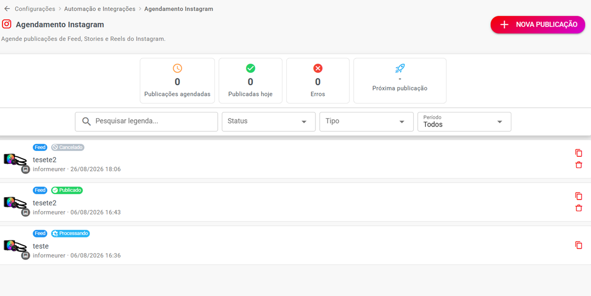

# Agendamento de Publicações no Instagram

> **Em palavras simples:** você escolhe a foto ou o vídeo, escreve a legenda e marca **dia e hora** — o Whazing publica no Instagram sozinho. Serve para quem cuida das redes sociais e quer deixar conteúdo pronto com antecedência. Não tem custo extra no Whazing; o custo é o do provedor que conecta o Instagram.

***

## ✅ Onde este recurso funciona

| Como o Instagram está conectado | Agenda publicações |
| --- | --- |
| **Hub MultiAPIWA** | ✅ |
| **Hub NotificaMe** | ✅ |
| **Conexão direta Meta** (aplicativo com permissão de publicação aprovada) | ✅ |
| **ConnectionHub** | ❌ |

> ⚠️ **ConnectionHub não publica.** Ele faz somente Direct. Veja [O que cada hub faz](../../canais-disponiveis/hubs/recursos-por-hub.md) para trocar de provedor.

***

## 📍 Onde encontrar

Acesse:

**Automação e Integrações → Agendamento Instagram**

***

## 📅 Tela de agendamento

A tela mostra as publicações já programadas e a situação de cada uma. Você pode:

* **Pesquisar pela legenda** — digite uma palavra para achar a publicação;
* **Filtrar por status** — por exemplo *Processando*, *Publicado* ou *Cancelado*;
* **Filtrar por período** — para ver o que foi agendado em uma data.

<figure><figcaption></figcaption></figure>

Na lista aparecem: nome da publicação, conta do Instagram, data e horário, tipo e status.

***

## ➕ Criar um novo agendamento

### 1. Escolha a conta

Selecione qual **conta do Instagram** vai receber a publicação. Se a empresa tiver mais de uma conta conectada, escolha a certa.

### 2. Escolha o tipo

| Tipo | O que é | Quando usar |
| --- | --- | --- |
| 🖼️ **Feed** | Publicação permanente no perfil | Fotos e conteúdos que ficam no perfil |
| ⏳ **Stories** | Conteúdo que desaparece em 24 horas | Avisos, promoções e conteúdos rápidos |
| 🎬 **Reels** | Vídeo curto | Vídeos no formato Reels |

### 3. Envie a mídia

Arraste o arquivo para a área **Enviar mídia** ou selecione do computador.

> 💡 Confira o arquivo antes de confirmar — depois de publicado, corrigir exige apagar no Instagram.

### 4. Escreva a legenda

No campo **Legenda**, escreva o texto que acompanha a publicação.

> Novidades chegando! 🚀 Confira nosso novo conteúdo.

A legenda é opcional quando o tipo de publicação permitir.

### 5. Marque data e hora

Na seção **Agendamento**, informe **Data / Hora** (ex.: `12/08/2026 17:27`).

> ⏰ O horário usado é o **fuso horário configurado para a empresa**. Antes de agendar algo importante, confira o fuso — veja [Fuso Horário](../../instalacao-and-vps/ajustefuso.md).

### 6. Confira o resumo e confirme

O sistema mostra um resumo com conta, tipo, arquivo, legenda, data e hora. Confira e confirme.

```text
Nova Publicação
      ↓
Escolher o Instagram
      ↓
Feed / Stories / Reels
      ↓
Enviar a mídia
      ↓
Escrever a legenda
      ↓
Escolher data e hora
      ↓
Conferir o resumo
      ↓
Confirmar
```

***

## 🟡 Status das publicações

| Status | O que significa |
| --- | --- |
| **Processando** | O sistema está enviando a publicação para o Instagram |
| **Publicado** | Já está no perfil |
| **Cancelado** | Não será publicada |

> 💡 Depois de agendar, volte à tela de **Agendamento Instagram** para conferir se a publicação foi concluída.

***

## 🆘 Problemas comuns

### A tela de agendamento não aparece (ou não lista meu Instagram)

O canal está conectado por um provedor que **não publica** (ConnectionHub) ou o tipo de canal não está liberado no plano. Veja [O que cada hub faz](../../canais-disponiveis/hubs/recursos-por-hub.md) e [Liberação de Canais para Empresas](../../modulo-saas/liberacao-de-canais.md).

### A publicação ficou em "Processando" e não foi ao ar

1. Confirme que a conta do Instagram está **ativa** e conectada.
2. Verifique se a mídia está no formato aceito pelo Instagram (imagem ou vídeo dentro dos limites dele).
3. Se o token do canal expirou, reconecte o Instagram.

### A publicação saiu na hora errada

O horário segue o **fuso da empresa**. Ajuste o fuso e reagende — veja [Fuso Horário](../../instalacao-and-vps/ajustefuso.md).

### Posso publicar no Facebook também?

Esta tela é do **Instagram**. A publicação no Facebook é feita direto na Página.

***

## 📚 Veja também

* [O que cada hub faz (comparativo)](../../canais-disponiveis/hubs/recursos-por-hub.md)
* [Usar o Instagram e o Facebook pelo hub](../../canais-disponiveis/hubs/instagram-e-facebook.md)
* [Automação de Comentários e Direct do Instagram](automacao-de-comentarios-e-direct-do-instagram.md)
* [Agendamento de Status (Stories) WhatsApp](agendamento-de-status-stories-whatsapp.md)
