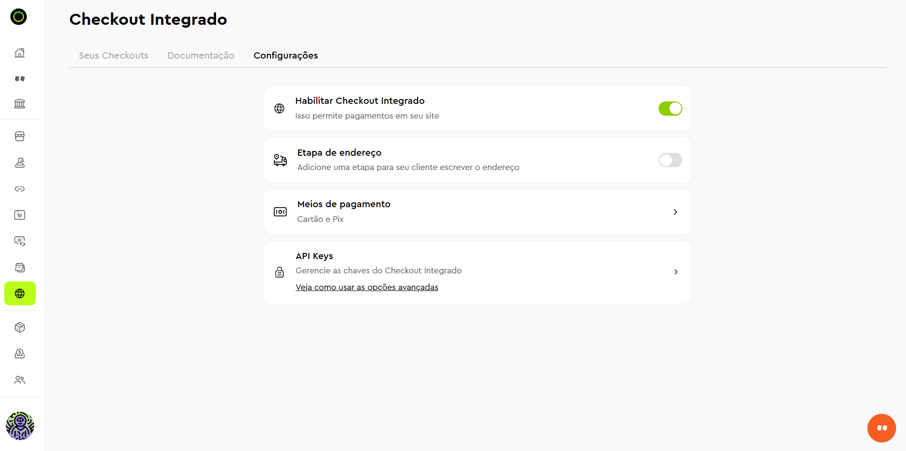

# InfinitePay

## 🚀 Primeiros Passos (Setup para Leigos)

Para começar a receber pagamentos via InfinitePay, siga estes passos simples:

### 1. Cadastre-se no InfinitePay

* Se ainda não tem cadastro, acesse o [aplicativo do InfinitePay](https://infinitepay.whazing.com.br/) e crie uma chave Pix
* No app, vá em **Área Pix → Chaves → Cadastrar chave** para criar sua chave Pix

### 2. Acesse o painel do Whazing

* No Whazing, acesse: **Painel SaaS → Comercial → Receitas → Configurações de Pagamento**
* Selecione o gateway **InfinitePay**
* Informe o **Infinite Tag** (aparece após o `$` no painel, ex: `informeurer`)

### 3. Configure as taxas e meios de pagamento

<figure><figcaption></figcaption></figure>

No painel do InfinitePay (em https://app.infinitepay.io/):

* Ative a opção **"Habilitar Checkout Integrado"**
* **Desative** a etapa de endereço
* Em **"Meios de pagamento"**, configure quais métodos estão disponíveis e as taxas

> ⚠️ **Importante:** Não é necessário configurar API Keys. O acesso ao Whazing é feito exclusivamente pela **Infinite Tag**.

Pronto! Seu Whazing está pronto para receber pagamentos.

***

## ⚠️ Faturas com "Erro Processar Pagamento"

Se você está tendo faturas que dão "erro processar pagamento", verifique o cadastro da empresa:

### 📋 Cadastro da Empresa é Obrigatório

Para o correto funcionamento dos pagamentos, a empresa deve ter os seguintes campos **corretamente cadastrados**:

* ✅ **Nome** completo
* ✅ **Telefone** com DDD
* ✅ **E-mail** válido

Se algum desses campos estiver incompleto ou errado, o pagamento pode falhar. Verifique e corrija no cadastro da empresa que faz o pagamento no **Painel SaaS - Empresas - Empresas**.

* Sempre apague as faturas com erro para o sistema gera fatura nova. Ele vai gerar automaticamente.

***

## 📋 Perguntas Frequentes (FAQ)

### P: Preciso configurar webhook no InfinitePay?

**R:** Não. A configuração é simplificada. A única coisa que você precisa é da **Infinite Tag**, que é configurada no painel do Whazing. O restante da configuração (gerar Pix, definir taxas, etc.) é feita diretamente no painel do InfinitePay em https://app.infinitepay.io/.

### P: Como ativar o Checkout Integrado?

**R:** No painel do InfinitePay (https://app.infinitepay.io/):

* Vá em **Checkout → Configurações**
* Ative a opção **"Habilitar Checkout Integrado"**
* Desative a **"Etapa de endereço"**
* Em **"Meios de pagamento"**, configure os métodos disponíveis e as taxas

### P: Preciso de API Keys para integrar?

**R:** Não, não utilizamos API Keys. O acesso ao Whazing é feito exclusivamente pela **Infinite Tag**.

### P: O que fazer se a fatura continuar com erro após cadastro completo?

**R:** Verifique os logs do sistema e confirme que o cadastro da empresa tem nome, telefone e email preenchidos corretamente.

***

## 🔧 Configuração no Painel do InfinitePay

Todas as configurações avançadas são feitas diretamente no painel do InfinitePay nada alterado pelo whazing:

Acesse: **https://app.infinitepay.io/**

1. **Checkout - Configurações**
   * Ative: **"Habilitar Checkout Integrado"**
   * Desative: **"Etapa de endereço"**
2. **Meios de pagamento**
   * Configure quais métodos estão disponíveis
   * Defina as taxas para cada meio
3. **Geração de Pix**
   * As configurações de Pix são feitas nativamente no InfinitePay

***

## ✅ Pronto para Receber

Depois de seguir todos os passos acima, seu Whazing está pronto para receber pagamentos via InfinitePay. Lembre-se:

* O cliente precisa completar o pagamento na tela do InfinitePay
* O cadastro da empresa deve ter nome, telefone e email preenchidos
* O Infinite Tag deve estar informado no painel do Whazing
