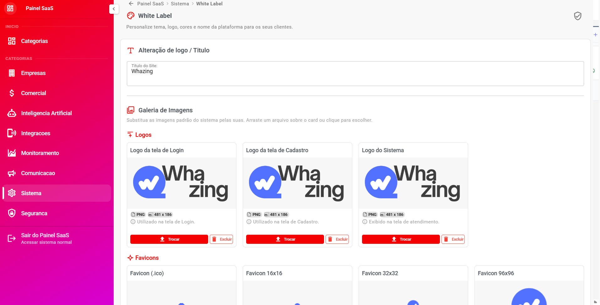

# Whitelabel

* Permitido apenas na **licença Premium**
*   É possível:

    * Trocar ícones, imagens e nome no painel

    💼 Tenha seu próprio sistema de atendimento com a sua marca!

    Transforme-se em um provedor de soluções digitais com nossa plataforma SaaS de multiatendimento.\
    Cadastre e gerencie várias empresas dentro de um só painel, ofereça o sistema como seu, venda com sua marca e lucre de verdade!\
    ✅ Personalize com sua identidade\
    ✅ Ganhe recorrência com cada cliente ativo\
    ✅ Atenda WhatsApp, Instagram, Facebook e muito mais\
    ✅ Modelo pronto para revenda: foco total no seu crescimento
* 🚀 Comece agora a gerar renda com um sistema de atendimento completo, fácil de gerenciar e pronto para escalar!

<figure><figcaption></figcaption></figure>

Maioria das imagens no formato PNG que deve ser usadas ao selecionar arquivo sistema indica qual formato e tamanho recomendado. Se for enviado formato diferente o arquivo não é alterado. E teste janela anônima ou limpe cache.

**Onde configurar**

As configurações de personalização da identidade visual estão disponíveis em:

**Painel SaaS → Sistema → White Label**

**Para quem é indicado?**

* Empresas de tecnologia e TI.
* Agências que oferecem soluções digitais.
* Revendedores de sistemas SaaS.
* Provedores de Internet.
* Empresas que desejam comercializar uma plataforma de atendimento com sua própria marca.

#### 💼 White Label Avançado – Sua plataforma com sua marca

Para empresas que desejam comercializar o Whazing como sua própria plataforma de atendimento, oferecemos recursos avançados de White Label.

Com essa modalidade, você pode apresentar o sistema aos seus clientes utilizando sua própria identidade visual, sem referências à marca Whazing.

**O que pode ser personalizado**

* ✅ Remoção das referências à marca Whazing no painel SaaS.
* ✅ Ocultação das informações de contato e identificação do Whazing.

**Requisitos para liberação**

Para utilizar os recursos avançados de White Label, é necessário:

* Possuir, no mínimo, **2 licenças Premium adquiridas**.

**Importante:** Os recursos avançados de White Label não são habilitados automaticamente. Após adquirir a quantidade mínima de licenças Premium, entre em contato com nossa equipe para solicitar a liberação.

***

📣 Quer receber novidades e comunicados oficiais do Whazing?

Entre no nosso Telegram:\
[Canal Oficial Whazing](https://t.me/whazing?utm_source=chatgpt.com)
